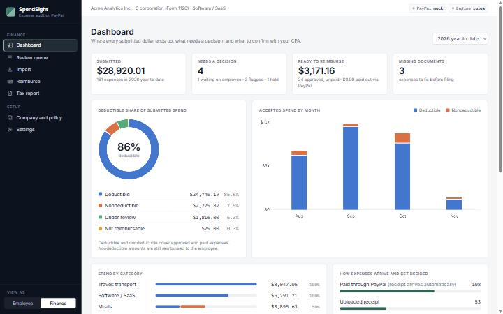
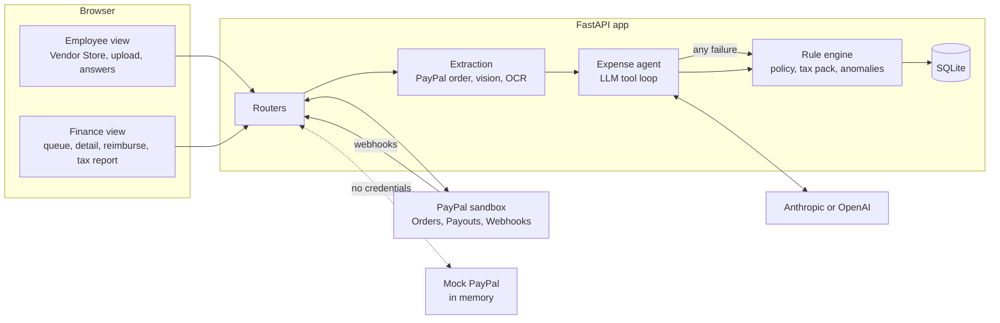

# SpendSight

**AI expense auditor for US corporations, built on PayPal.** For every expense it answers two questions:
is it *reimbursable under company policy*, and *how much is tax deductible under 2026 US rules*.

- Demo video: _to be added before submission_
- Hosted demo: _to be added after the Render deploy_



## The problem

Companies hand employees spending power, and soon AI purchasing agents too. Finance teams then spend
hours checking every expense: was it really for work, does it break policy, and how much of it can the
company deduct on its Form 1120? The answers are different. A $186 client dinner is fully reimbursable
but only 50% deductible. Office snacks are reimbursable but, from 2026, 0% deductible (IRC §274(o)).

SpendSight is for finance teams at US C corporations and for the CPA who closes their books.

## How it works

1. **Buy through PayPal.** The employee pays a vendor with PayPal. The itemized order becomes the
   receipt: vendor, date, lines, total. No upload, no OCR, no typing.
2. **Or upload a receipt.** AI vision reads it; without an AI key, Tesseract OCR and a regex parser do.
   Finance can also **import PayPal history** for purchases made outside SpendSight; those arrive
   without a purpose, so the agent asks the employee for it.
3. **Review.** An expense agent decides category and tax rule per line, checks the business purpose,
   and asks the employee a specific question when something is missing (for example, who attended).
4. **Hold.** Purchases above the pre-approval threshold are only *authorized* at PayPal. Finance
   approves (capture) or rejects (void), so no money moves before review.
5. **Reimburse.** Approved expenses go out in one PayPal Payouts batch, one payment per employee.
6. **Close.** The tax report shows deductible and nondeductible amounts by category and Form 1120
   line, lists missing substantiation, and exports a CPA package (XLSX, CSV).

Every decision shows which engine produced it (`llm` or `rules`) and a plain one-sentence reason.

## How PayPal is used

| API | Where | Status |
|---|---|---|
| Orders v2: create (itemized, `custom_id` = expense id) | `POST /api/paypal/orders` in `app/routers/paypal_checkout.py` | implemented |
| Orders v2: capture / authorize / get | `POST /api/paypal/orders/{id}/complete` | implemented |
| Payments v2: capture or void an authorization | Finance approve / reject on a held expense | implemented |
| Payouts v1: create batch, get batch | `app/routers/reimburse.py` | implemented |
| Webhooks: receive, verify signature, store once | `POST /webhooks/paypal` in `app/routers/webhooks.py` | implemented |
| PayPal JS SDK buttons | Vendor Store page | implemented |
| Transaction Search v1: account history, paged, max 31 days | Finance **Import** page, `POST /api/paypal/import` in `app/routers/paypal_import.py` | implemented (backfill only) |

All calls go through one thin client (`app/paypal/client.py`). `app/paypal/mock.py` implements the same
interface in memory and is used automatically when no PayPal credentials are set.

Webhook events handled: `PAYMENT.CAPTURE.COMPLETED`, `PAYMENT.AUTHORIZATION.CREATED`,
`PAYMENT.AUTHORIZATION.VOIDED`, `PAYMENT.PAYOUTSBATCH.SUCCESS`, `PAYMENT.PAYOUTSBATCH.DENIED`,
`PAYMENT.PAYOUTS-ITEM.SUCCEEDED`, `PAYMENT.PAYOUTS-ITEM.FAILED`, `PAYMENT.PAYOUTS-ITEM.UNCLAIMED`.
`CHECKOUT.ORDER.APPROVED` is stored only. Nothing depends on webhooks arriving: captures are handled
synchronously and payout status is also polled.

## How AI is used

| Step | With an AI key | Without a key, or when the key fails |
|---|---|---|
| Expense review | Tool-calling agent (`app/ai/agent.py`): reads the expense, looks up tax rules and employee history, then submits a decision or asks the employee | Rule engine (`app/rules/engine.py`) |
| Receipt reading | Vision extraction (`app/extract/vision.py`) | Tesseract OCR + regex parser (`app/extract/ocr.py`) |
| Policy document | Summary and rule table in one call | TextRank summary (`sumy`) + regex rule extraction; optional local Hugging Face model |

The AI chooses *which category and why*. The tax rule pack (`app/rules/us_2026.json`) always decides
*the percentage*, and policy limits, required substantiation and anomaly checks from the rule engine
are applied on top of the AI's decision.

If a key is present but fails (invalid, out of credit, rate limited, timeout), the request falls back
to the rule engine and a banner says so. The app never blocks on AI.

Providers: Anthropic (`ANTHROPIC_API_KEY`, default model `claude-opus-5-5`) or OpenAI
(`OPENAI_API_KEY`, default `gpt-6.1-sol`); Anthropic wins if both are set. A key can also be pasted
in Settings, where it is kept in server memory only.

## Architecture



Stack: Python 3.11, FastAPI, SQLModel on SQLite, Jinja2 + Alpine.js + Tailwind (CDN, no build step),
AG Grid Community, Chart.js, `httpx`, `openpyxl`.

## Quick start

No keys are needed. PayPal runs on the in-memory mock and all decisions come from the rule engine.
The database is seeded on first start: Acme Analytics Inc., 3 employees, 90 days of history.

Docker:

```bash
docker build -t spendsight . && docker run --rm -p 8000:8000 spendsight
```

Local (Python 3.11 or newer):

```bash
python -m venv .venv
.venv/Scripts/python -m pip install -r requirements.txt   # macOS/Linux: .venv/bin/python
.venv/Scripts/python -m uvicorn app.main:app --reload
```

Open http://localhost:8000 and use the role switcher in the header (Employee view / Finance view).

Tests:

```bash
.venv/Scripts/python -m pytest -q
```

Receipt OCR needs the Tesseract binary. The Docker image includes it; locally, install Tesseract or
fill in the receipt form by hand. Reset the demo data with `python seed.py --reset`.

## Configuration

Copy `.env.example` to `.env`. Everything is optional.

| Variable | Purpose |
|---|---|
| `PAYPAL_CLIENT_ID`, `PAYPAL_CLIENT_SECRET` | Sandbox REST app credentials. Empty means mock mode. |
| `PAYPAL_WEBHOOK_ID` | Webhook id used to verify event signatures. |
| `ANTHROPIC_API_KEY`, `ANTHROPIC_MODEL` | Enable the AI agent with Claude. |
| `OPENAI_API_KEY`, `OPENAI_MODEL` | Used when no Anthropic key is set. |
| `ENABLE_LOCAL_SUMMARIZER` | `1` to summarize policies with a local Hugging Face model (`pip install -r requirements-local-ml.txt`). |
| `COMPANY_TZ` | Time zone for weekend, late-night and same-day checks. Default `America/Los_Angeles`. |
| `DATABASE_URL` | Default `sqlite:///./spendsight.db`. |

## PayPal sandbox setup

1. In the [PayPal Developer Dashboard](https://developer.paypal.com/dashboard/), open
   **Apps & Credentials**, switch to **Sandbox**, and create a REST app. Copy the client id and secret
   into `PAYPAL_CLIENT_ID` and `PAYPAL_CLIENT_SECRET`.
2. In the app's features, enable **Payouts** and **Transaction Search**.
3. Under **Testing Tools > Sandbox Accounts**, use the default business account as the company and
   create personal accounts: one to pay with in the Vendor Store, and one per employee to receive
   payouts. Put the employees' sandbox emails on the employee records (seeded with placeholders).
4. Add a webhook on the app pointing at `https://<your-host>/webhooks/paypal` and subscribe to the
   events listed above. Copy the webhook id into `PAYPAL_WEBHOOK_ID`.
5. Restart. The header badge changes from `PayPal: mock` to `PayPal: sandbox`, and the Vendor Store
   shows the real PayPal button.

Sandbox payouts need a funded sandbox business balance.

## Deploy on Render

`render.yaml` describes one Docker web service. Create a new **Blueprint** from this repository, set
the secret environment variables in the dashboard, deploy, then register the service URL as the
PayPal webhook (step 4 above). On the free plan the disk is ephemeral, so the SQLite database and
uploaded receipts are reseeded on each deploy.

## Running without keys

Everything works with no AI key and no PayPal credentials: the rule engine decides, Tesseract reads
receipts, TextRank and regex read policies, and the mock PayPal client simulates orders,
authorizations and payouts (payouts succeed after three seconds).

## Tax disclaimer

Prepared to support review by a qualified tax professional. Not tax advice. Tax treatments, citations
and Form 1120 line mappings come from a data file (`app/rules/us_2026.json`) in which every entry is
marked `verify_with_cpa`.

## Sponsor tools

- **AG Grid Community**: the Finance queue (status filters, grouping, row selection for payouts,
  inline category edits) and the editable policy table in onboarding.
- **Render**: Docker web service defined in `render.yaml`.

## License and author

MIT. Copyright (c) 2026 Minseo Kim (minsmseo@gmail.com).
